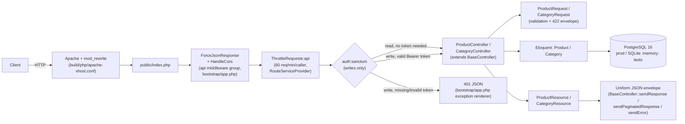
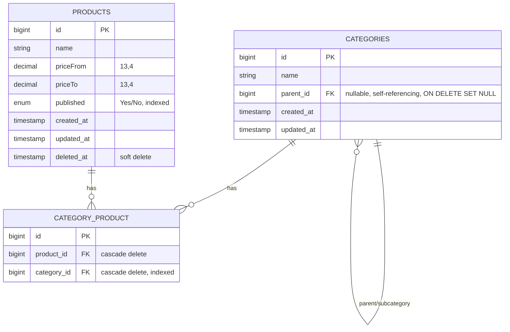

# Architecture — product-catalog-api

Written by the Phase 3 audit (`auditor`), 2026-11-06, from the real code at HEAD. Nothing here is
inferred from the repo name or from memory of similar projects.

## What the system is

A single Laravel 12 / PHP 8.4 JSON API that manages a product catalogue for "a company brief":

- **Categories** form a tree (self-referencing `parent_id`): a category is either top-level or a
  subcategory of exactly one other category.
- **Products** carry a name, a price range (`priceFrom`..`priceTo`, 4-decimal money), a `published`
  flag (string enum `Yes`/`No`), a soft-delete, and belong to **2 to 10** categories through the pivot
  table `category_product`.
- Reads (`GET`) are open to anyone. Writes (`POST`/`PUT`/`DELETE`) require a Sanctum personal-access
  token, issued by a custom Artisan command (`php artisan api:token <email>`), not by any HTTP
  endpoint.

There is no second real service behind this repo: the Node/npm/Vite manifests at the repo root
(`package.json`, `vite.config.js`, `resources/js|css`) are **not wired into any build step** — see
"The npm/Vite layer" below. The only page the app serves is the stock Laravel welcome page at `/`.

## Request flow

## Layering

Thin-controller MVC, no service/repository layer — appropriate for this repo's actual complexity
(two entities, CRUD plus one pivot, no multi-step workflows):

- **`app/Http/Controllers/API/{Product,Category}Controller.php`** — one controller per resource,
  both extend `BaseController` for the shared response envelope. Controllers call Eloquent directly;
  there is no intermediate service or repository class, and none is warranted at this size (see
  `docs/TECHNICAL_DEBT.md`'s "not treated as debt" section and Phase 8's plan below).
- **`app/Http/Requests/API/{Product,Category}Request.php`** — `FormRequest` validation, each
  overrides `failedValidation()` to keep the `{success:false, message:"Validator", data:{errors}}`
  envelope instead of Laravel's default 422 shape.
- **`app/Http/Resources/API/{Product,Category}Resource.php`** — `JsonResource` transformers. Note
  `ProductResource` reads `$this->categories` from an **already eager-loaded** relation (see
  N+1 note below) and derives `status` (`Active`/`Deleted`) from `deleted_at`.
- **`app/Models/{Product,Category,User}.php`** — Eloquent models. `Product` uses `SoftDeletes`;
  `Category` does not (hard delete, guarded only at the controller level — see
  `docs/REPOSITORY_AUDIT.md` P2-1).
- **`app/Support/PerPage.php`** — the one small cross-cutting helper in the codebase: centralizes the
  "15 default / 100 max" pagination rule so both controllers call one place (`PerPage::from($request)`)
  instead of repeating the bound-checking logic. This is DRY already correctly applied at the one spot
  that needed it.
- **`app/Console/Commands/IssueApiToken.php`** — the only way a caller obtains a token; creates the
  `User` row on first use (`firstOrCreate`) so a fresh install can issue a token immediately.

## Routing and middleware — a Laravel ≤10-style provider still does the wiring

Laravel 11/12's own skeleton normally registers routes and rate limiters directly in
`bootstrap/app.php` (`->withRouting(...)`) and has no `RouteServiceProvider`/`EventServiceProvider` by
default. This repo still has, and still actively uses, the pre-11 style:

- `app/Providers/RouteServiceProvider.php` (registered in `bootstrap/providers.php`) loads
  `routes/api.php` under the `api` middleware + `/api` prefix and `routes/web.php` under `web`, **and**
  defines the named rate limiter `RateLimiter::for('api', ...)` (60/min, keyed by user id or IP).
- `bootstrap/app.php` separately prepends `ForceJsonResponse`/`HandleCors` and appends
  `ThrottleRequests::class.':api'` to the `api` middleware group — this `'api'` name is the limiter the
  legacy `RouteServiceProvider` defines.

The two files cooperate correctly today (verified by reading both, and by the fact `ProductApiTest`/
`CategoryApiTest`'s auth/validation paths all pass against this wiring) — this is not a bug. It is,
however, exactly the "structure matches the upgraded stack's conventions" gap Phase 7 is scoped to
close: a Laravel 12 project with no real reason to keep the pre-11 `RouteServiceProvider` pattern
should migrate route/rate-limiter registration fully into `bootstrap/app.php` and drop the class. See
`docs/REPOSITORY_AUDIT.md` P2-2 and the Phase 7 plan below.

`app/Providers/AuthServiceProvider.php` (policy map, currently empty — no policies exist) and
`app/Providers/EventServiceProvider.php` (`shouldDiscoverEvents() => false`, one stock
`Registered → SendEmailVerificationNotification` mapping that is never triggered because nothing
calls `Auth::routes()`/registration) are both harmless legacy-style boilerplate, not actively
load-bearing beyond what Laravel's own auth scaffolding expects.

## Authentication and authorization

- **Sanctum personal access tokens** (`Laravel\Sanctum\HasApiTokens` on `User`), checked by
  `auth:sanctum` middleware on the write-only route group in `routes/api.php`. No session/cookie auth
  path is used for the API (the `sanctum.guard = ['web']` / stateful-domains config is Sanctum's
  default and is not exercised — this API is pure bearer-token).
  There are no roles/scopes: every valid token can write to every resource — single-tier auth, matching
  "a company brief"-sized tool, not a gap at this scope.
- Tokens never expire (`config/sanctum.php`'s `'expiration' => null`) — self-documented in the
  repo's own README "Known limitations".
- `bootstrap/app.php` overrides the default `AuthenticationException` renderer so an unauthenticated
  API request gets `401 {"success":false,"message":"Unauthenticated."}` instead of a redirect to a
  non-existent `login` route — a deliberate, verified fix (there is no web login page in this API-only
  app).

## Data model

Full schema/constraint/index detail, including what is **missing** (no FK-column index on
`categories.parent_id`, no child-category check on category delete, no DB-level enforcement of the
2-10 category business rule) is in `docs/REPOSITORY_AUDIT.md`'s Database section.

## N+1 status: previously a real bug, now fixed and verified clean

Both listings eager-load the one relation they render:

- `ProductController::index()` — `Product::withTrashed()->with('categories')->...` (one query for
  products, one for the pivot+category join, regardless of page size).
- `CategoryController::index()` — `Category::with('subcategory')->...` (one level of children
  eager-loaded; the tree is not recursively loaded beyond one level, which is correct — the API has no
  endpoint that renders a full nested tree).

`ProductResource`'s own doc-comment records that this used to be an N+1 ("the resource called the
controller of the category for every single product") before the eager-load was added — current code
has no N+1 in either listing. No further N+1 was found anywhere else in the controllers.

## The "deleted product stays in the listing" design, and where it breaks down

`ProductController::index()` deliberately calls `withTrashed()` — this is **documented, intentional
behavior**, not a bug: `docs/api.md` states "`status`: `Active` or `Deleted`. A deleted product stays
in the listing on purpose." `ProductResource::status` exists specifically to surface this.

What is **not** documented or tested: `ProductController::show()` and `::update()` both use the plain
`Product::find($id)` (no `withTrashed()`), so a soft-deleted product that a client just saw in the
listing (with `status: "Deleted"`) 404s the instant the same client calls `GET /api/product/{id}` on
it. See `docs/REPOSITORY_AUDIT.md` P1-2 for the fix options.

## The npm/Vite layer: present, inert, not part of this architecture

`package.json`/`vite.config.js`/`resources/{js,css}` declare a small Vite/Laravel asset pipeline, but:

- Neither `build/php/Dockerfile` nor `.github/workflows/ci.yml` installs Node or runs `vite build`.
- No Blade view calls `@vite(...)` (`welcome.blade.php` is pure static HTML).
- The committed `package-lock.json` doesn't even match the current `package.json`'s ranges, and a bare
  `npm install` against the current manifest fails on a live peer-dependency conflict
  (`laravel-vite-plugin@^3` needs `vite@^8`, `package.json` pins `vite@^6`) — detail in
  `projects/info/deps/product-catalog-api.md` (Phase 2).

This layer has zero effect on the running application today. It is **not** treated as a second
ecosystem this repo's architecture depends on — see this repo's Phase 4-11 plan in
`projects/info/analysis/product-catalog-api.md` for the explicit recommendation on what to do with it.

## Strengths worth preserving (so later phases don't accidentally regress them)

- The response envelope (`success`/`message`/`data`, plus `links`/`meta` for paginated lists) is
  applied consistently across every endpoint via `BaseController` — no endpoint improvises its own
  shape.
- Several real bugs were already found and fixed in this codebase, with the fix and the regression
  test both left in place and documented inline (category existence validation on product write,
  category lookup before delete, category sync on update, the `App\Category` → `App\Models\Category`
  relation-namespace bug, the `parent_id` FK integer-width mismatch, the per-product N+1 above). This
  is a better-than-average starting baseline for this program — later phases should treat the existing
  tests as a real regression contract (CLAUDE.md's baseline-preservation rule), not as scaffolding to
  rewrite freely.
- Docker image: multi-stage (`base → vendor/vendor-prod → test/runtime`), both base images pinned by
  digest, runs as non-root `www-data`, has a `HEALTHCHECK`. This needs *upgrading*, not *building from
  zero*, unlike several other repos already onboarded in this program.
- `README.md`/`docs/api.md` already honestly document real limitations (no search, no versioning, no
  parent-cycle check, tokens don't expire, no license file) — this phase's own findings corroborate
  rather than contradict the repo's own documentation, which is itself a good sign about this
  codebase's honesty.
